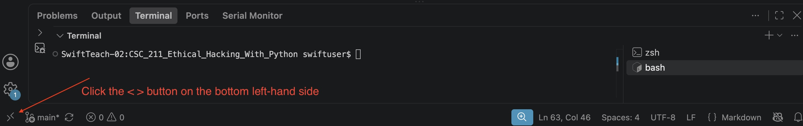
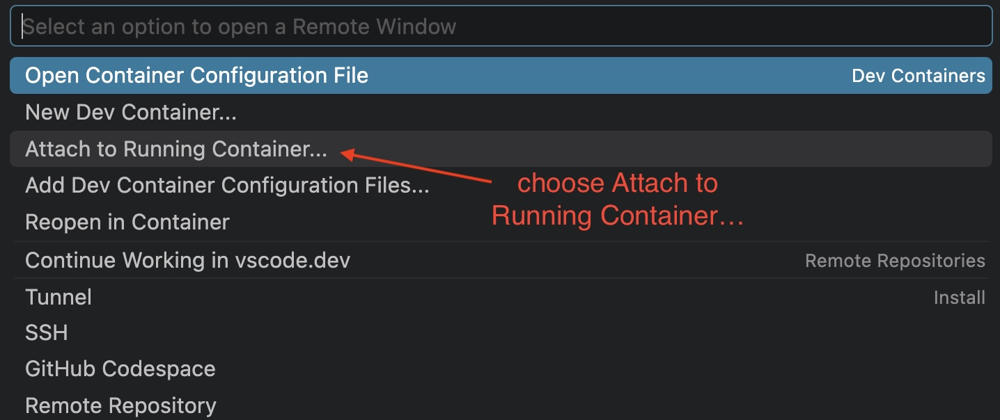

### Week 3 Lab 3: Assignment: Active Reconnaissance(Direct Network Probing) Continued

#### [NICE Framework Reference](https://github.com/jadTalbert/NICE_Framework/)

- Role: [JRT-1](https://github.com/jadTalbert/NICE_Framework/blob/main/NICE_Framework/roles/roles.md)
- Tasks: [T-03,T-04,T-06,T-07,T-09,T-10,T-11,T-13,T-14,T-16,T1070,T1341,T1619](https://github.com/jadTalbert/NICE_Framework/blob/main/NICE_Framework/tasks/tasks.md)
- Skills: [S-02,S-03,S-05,S-06,S-10,S-13,S-17,S-19,S0532,S0543,S0572,S0597,S0688](https://github.com/jadTalbert/NICE_Framework/blob/main/NICE_Framework/skills/skills.md)
- Knowledge: [K-02,K-03,K-05,K-08,K-10,K0674,K0680,K0682,K0683,K0797,K0813,K0833,K0882,K0924,](https://github.com/jadTalbert/NICE_Framework/blob/main/NICE_Framework/knowledge/knowledge.md)

### Context
The CSO is putting you under a bit more pressure to get things done faster, and after learning how to ping servers using Python in the previous hacking exercise, you're feeling a bit more confident in your White-Hat Hacking abilities. You have learned through past conversations with other colleagures, that port scanning is an important aspect of Ethical Hacking and you move on to scanning TCP Ports on these same docker containers(e.g. the `student-recon` docker container).


### Port Scanner:
You sit down and think about how you want to approach this problem, and decide the most obvious file name for this python program will be `tcp_scanner.py`. However, you don't recall exaclty what TCP stands for nor what it is used for, so you do some research using Google's Gemini AI platform and prompt the AI with this statement: `Explain in layman terms what TCP stands for and what it does.`

After your research is complete, you have a better idea of what you need to accomplish, but you still don't quite understand how to accomplish port scanning using python. Therefore, you need to do more research. 

Using Gemini again for your task, you prompt the AI with the following: `tell me about the python libraries that can help me complete an ethical port scan for my employer`.

Based on your new found knowledge of sockets, you meet with your team and explain what you have learned and ask two colleagues to take your research and build a python program that will allow the team to perform port scans. You also let them know that this has to be time-boxed, as the CSO is interested in getting this done quickly.

After your co-workers complete the program, you realize they used Generative AI to do this for them and there are no comments in the code. In order for others to understand the code in the future, you take the time to understand the logic and properly comment the code.


### tcp_scanner.py File

```python

##################################################################
# You should take the time and comment the code in this #program #
##################################################################

import socket
import sys

COMMON_PORTS = {
    21: "FTP",
    22: "SSH",
    25: "SMTP",
    53: "DNS",
    80: "HTTP",
    443: "HTTPS",
    1194: "OpenVPN",
    3000: "Node / Dev Frontend",
    3306: "MySQL / MariaDB",
    5432: "PostgreSQL",
    8080: "HTTP-Alt / Dev-API",
    27017: "MongoDB",
    6379: "Redis"
}

def scan_target(target_ip: str, ports: dict, timeout: float = 0.8):
    print(f"[*] Scanning Target: {target_ip}")
    print(f"{'PORT':<10} {'STATE':<10} {'SERVICE'}")
    print("-" * 35)

    open_ports = []
    for port, service_hint in ports.items():
        s = socket.socket(socket.AF_INET, socket.SOCK_STREAM)
        s.settimeout(timeout)
        
        # connect_ex returns 0 on successful TCP handshake (SYN -> SYN-ACK -> ACK)
        result = s.connect_ex((target_ip, port))
        if result == 0:
            print(f"{port:<10} {'OPEN':<10} {service_hint}")
            open_ports.append(port)
        s.close()
        
    print("-" * 35)
    return open_ports

if __name__ == "__main__":
    target = sys.argv[1] if len(sys.argv) > 1 else "172.29.0.20"
    scan_target(target, COMMON_PORTS)
```

You realize the in order to comment the code, you have to be able to execute it to understand what it's doing. So, you use VS Code to launch the `victim-server` docker container, so that you can copy/paste the code into a new file named `tcp_scanner.py` and execute it. Fortunately, you kept good notes from previous your vulnerability scans and you realize that you should use this reference to launch the `victim-server` docker container:







### How To Submit This Lab:
- Record a 2-3 minute video showing me that you know how to launch the `victim-server` docker container within VS Code and that you can execute the code and show the open ports that were scanned on the server.
- Upload your `tcp_scanner.py` file with the necessary comments that explain the logic and how the program works. These should be your comments and not comments created through generative AI.
